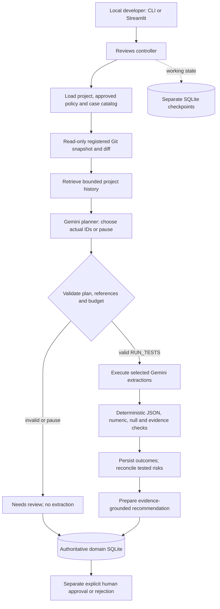

# PromptPatch architecture

One local developer repeatedly reviews versioned settlement-extraction prompts.
One LangGraph coordinator uses an LLM planner; a deterministic validator scores
only the actual selected executions. The fictional measurements are controlled
test data, not engineering advice. CLI and Streamlit use the same services.

## Contracts and boundaries

| Capability | Input/output | Permission |
|---|---|---|
| Git evidence | Project, registered full SHA and allowlisted relative path → blob/hash/source ref and real diff | Read-only bounded local Git; no agent edits/commit/release |
| Memory | Project, retrieval filters and bounds → risk/outcome/feedback/correction rows and source refs | Project-scoped audited reads; no pending correction presented as approved |
| Model execution | Candidate snapshot, fictional snippet and bounded model settings → raw response, usage, latency or safe error | Gemini endpoint, no function calling, SDK retry loop or continuation |
| Validation/persistence | Actual output + approved references/rules → discrepancies, immutable result and event | Transactional SQLite write with stable operation key |

The ten graph nodes are `load_context`, `read_sources`, `read_long_term_memory`,
`plan_tests`, `validate_plan`, `run_tests`, `validate_outputs`,
`reconcile_failures`, `write_memory_and_audit`, `prepare_recommendation`.
The controller saves request metadata atomically with a new cycle, pins policy,
verifies source ownership and restores original settings on resume. The UI does
not implement another agent or bypass those services.

The LLM chooses RUN_TESTS, REQUEST_CLARIFICATION or HOLD_FOR_APPROVAL, actual
catalog test IDs, concise reason, intent and evidence citations. Python checks
schema, project ownership, allowlisted IDs, required tests, budget and citations.
Invalid output produces needs_review without substituting a fixed test list.
Candidate execution is a distinct model purpose from planning; logs distinguish
both. A decision summary is retained, not private chain-of-thought.

The validator strictly checks JSON shape, duplicate keys/nonfinite numbers,
number/null semantics, Decimal tolerance and source evidence substrings. Ambiguous
or unsupported-unit inputs remain uncertain. Failures recommend revision;
uncertainty/errors/unresolved risks or prior rejection require review. All selected
passes with no unresolved risks/rejection may recommend a promotion candidate.
This concerns selected coverage, not the entire unexecuted catalog.

Only explicit owner approval creates a human decision. An approved policy
correction changes current criteria; it is not prompt release approval. Neither
action is teacher approval, deployment, a Git edit or a push.

## Interface and configuration

The CLI exposes initialization, fixture seeding, review list/start/status/resume,
memory, policy proposal/approval, version approval/rejection, logs and telemetry.
Streamlit adds a local review dashboard, project/version/cycle selectors, result
and evidence views, saved memory/feedback, policies and release decision forms.
Initial rendering/refresh and browsing history never initiate model inference.
Submission of a review/resume is explicit; replay is clearly labeled. Fixed
replay fixtures demonstrate edge cases, not live model intelligence.

Configuration comes from process environment. The optional UI launcher can parse
an explicitly named env file as data and pass only recognized variables, without
shell evaluation. External environment values take precedence. No key is entered
into model context or shown in widgets. The UI binds loopback, disables anonymous
usage statistics and is intended for the trusted local owner, without multi-user
authentication. See [README](../README.md) for commands and limits.

## Persistence, reliability and evaluation

The [memory schema](MEMORY_SCHEMA.md) separates source, long-term task history and
working checkpoints. Durable result/operation rows and one decision per cycle
avoid duplicate logical actions under retry. Bounded failures are logged. Unknown
in-flight external calls fail closed; no exactly-once remote billing claim is made.
Hosted LangSmith tracing is disabled for graph runs. App refresh reads persisted
state, not a private cached alternative. Archive preserves history and blocks new
work.

All snippets, Git prompts, comments, memory and model outputs are untrusted data.
They cannot expand allowed paths, project identity, approval methods or policy.
No dynamic model code, shell command or repository write capability exists.
UI data is displayed as text, structured tables or JSON; static styling never
interpolates source/model content into HTML. Recognized credential boundaries
protect writes, restored checkpoints, logs and exports. Local trusted checkpoint
files and arbitrary-secret detection remain explicit limitations.

The original three live cycles and process restart are retained in
`artifacts/demo/`. Ten offline control scenarios passed; three live paired
comparisons scored 1/3 versus 1/3, with quota limiting two arms. Only one pair
completed without provider errors. Synthetic conditioning histories, actual live
decisions, unsuccessful criteria and prior deadline failures are distinguished.
No statistical superiority is claimed. Current measurements are linked through
[evaluation results](EVALUATION_RESULTS.md).

Implementation references: [graph](../src/promptpatch/graph.py),
[controller](../src/promptpatch/reviews.py), [planner](../src/promptpatch/planner.py),
[approvals](../src/promptpatch/approvals.py), [telemetry](../src/promptpatch/telemetry.py).
Dependencies provide graph persistence, SDK transport and UI rendering; repository
contracts and measurements are inspectable project code. Consult the
[official LangGraph persistence docs](https://docs.langchain.com/oss/python/langgraph/persistence)
and [Streamlit testing docs](https://docs.streamlit.io/develop/api-reference/app-testing/st.testing.v1.apptest)
for those dependency APIs.
